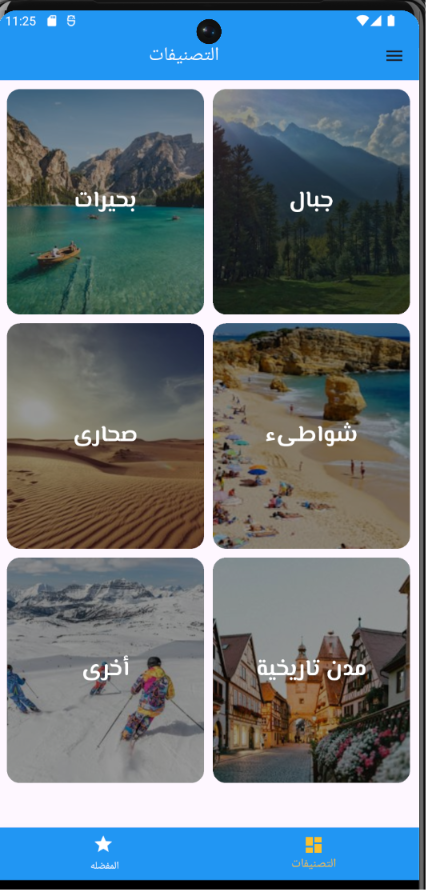
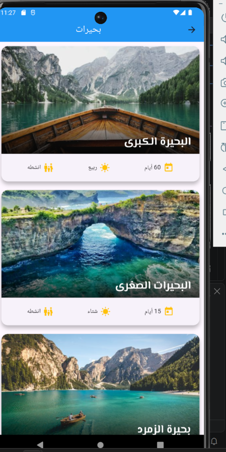
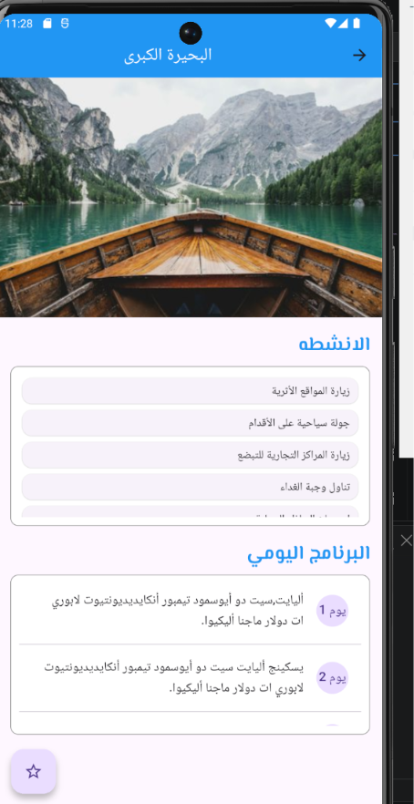
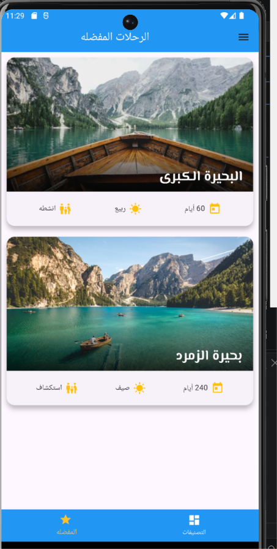
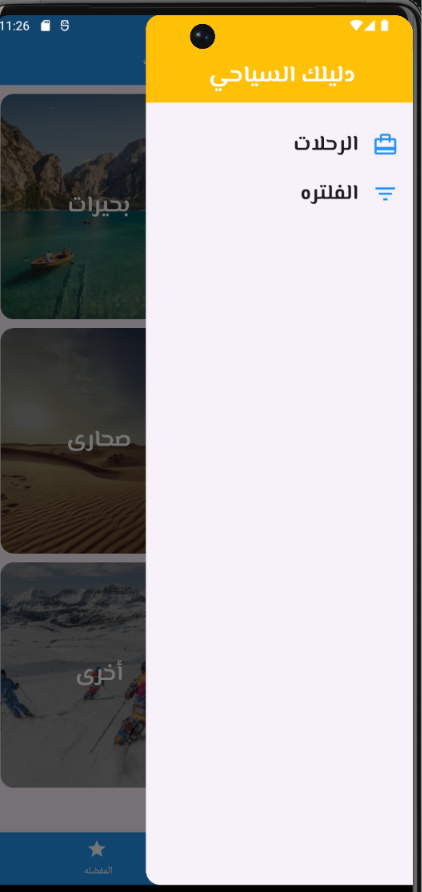

# 🧭 Tour Guide App

A smart Flutter application designed to help users explore and plan their tourist trips easily. It allows users to browse different types of trips, save favorites, and view detailed information using Data Models, with full support for Arabic language libraries and typography.

---

## 🌟 Key Features

* **Home Screen:** Displays all available trip categories (e.g., Summer trips, Winter trips, Cultural trips, etc.) in an organized and attractive design.
* **Trip Details Screen:** Navigates from any selected category (such as summer trips) to display a list of specific trips with comprehensive details.
* **Favorites Screen:** Allows users to bookmark and save their favorite trips for quick access anytime.
* **Data Models:** Built using structured Dart `Models` to ensure smooth and reliable data flow across screens.
* **Arabic Language Support:** Integrated Arabic localization and text-handling libraries to ensure a seamless Right-to-Left (RTL) experience.

---

## 📸 App Screenshots

<table>
  <tr>
    <td align="center"> <em>Home Screen</em></td>
    <td align="center"> <em>Trip Categories</em></td>
  </tr>
  <tr>
    <td align="center"> <em>Details Screen</em></td>
    <td align="center"> <em>Favorites Screen</em></td>
  </tr>
  <tr>
    <td colspan="2" align="center"> <em>Additional Screen</em></td>
  </tr>
</table>

---

## 🛠️ Tech Stack

* **Framework:** Flutter (Dart)
* **State Management & Navigation:** StatefulWidget / Navigator for smooth page transitions.
* **Data Structure:** Dart Models (Object-Oriented Programming).
* **Localization / Arabic Support:** Arabic language text and formatting packages.

---
